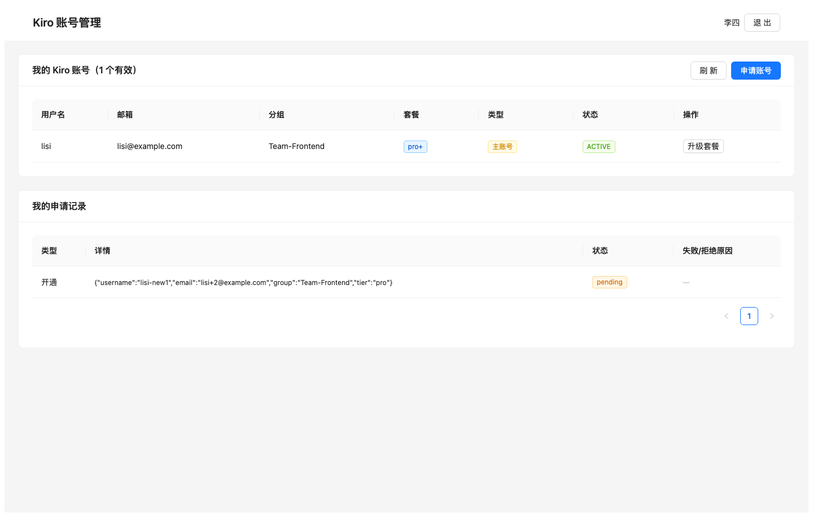
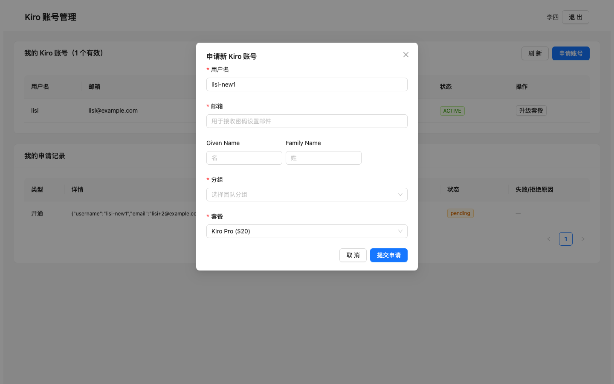
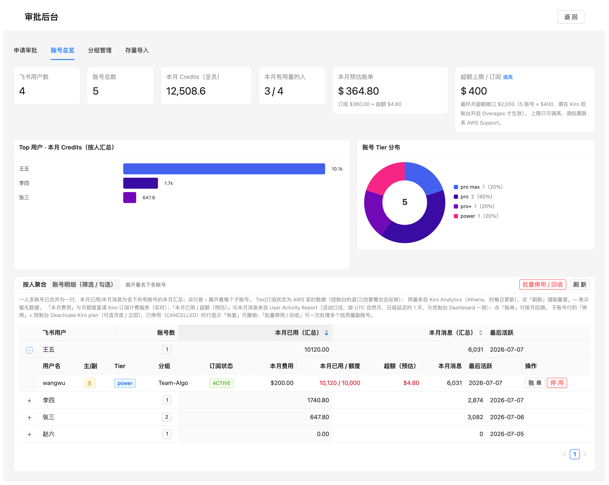
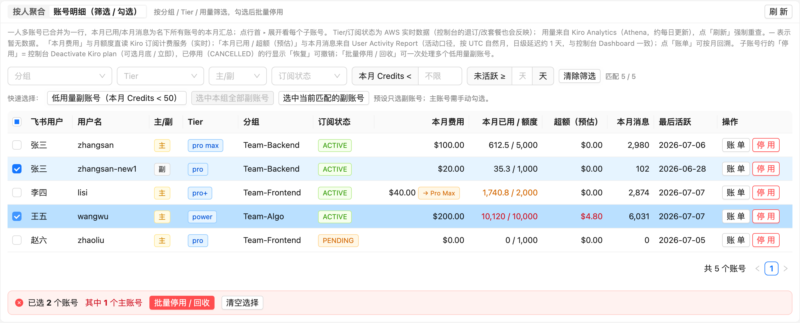
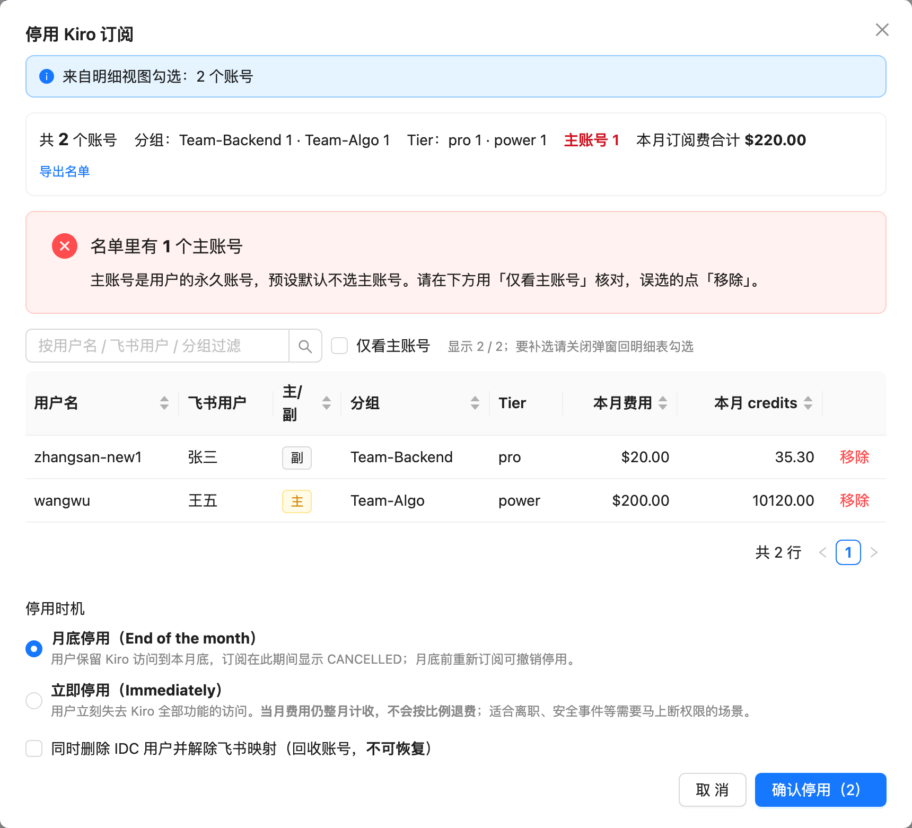
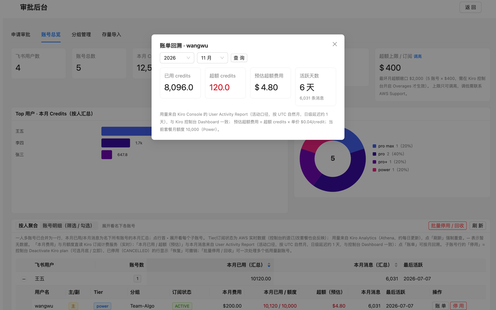
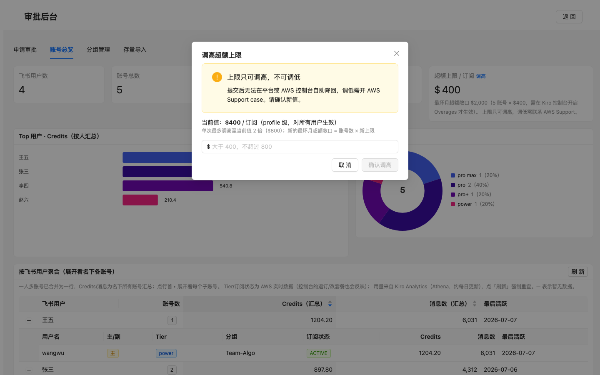
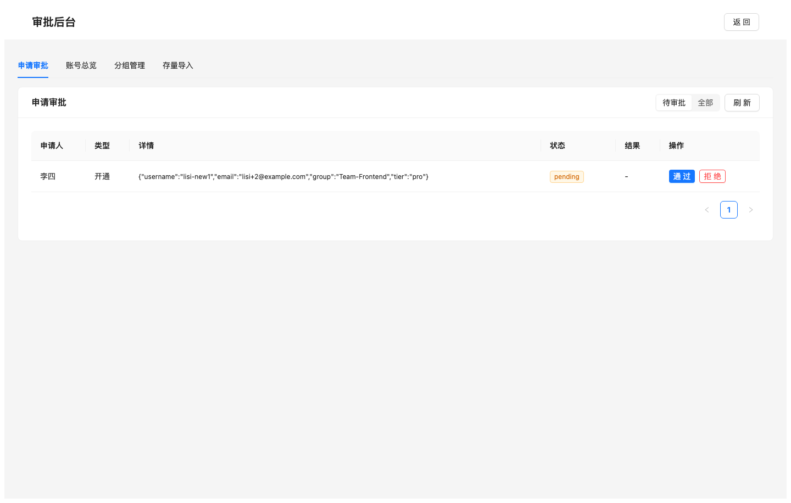
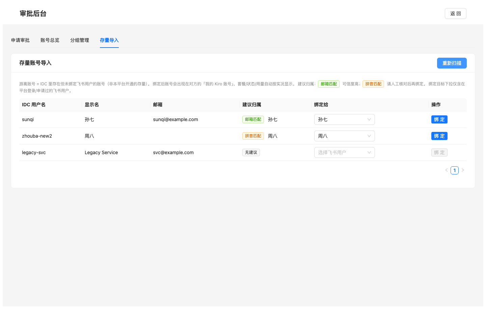

# Kiro 账号管理平台

> Kiro 账号自助管理：飞书 OAuth 登录 → Web 自助申请 → 飞书卡片审批（免公网 WS 长连接）
> → 自动开通 IDC 用户/加组/发密码邮件/Kiro 订阅 → DynamoDB 映射（UserId 锚点）。
> 产品文档见 [docs/PRODUCT.md](docs/PRODUCT.md)；部署与联调清单见 [docs/DEPLOY-AND-VERIFY.md](docs/DEPLOY-AND-VERIFY.md)；架构图见 [docs/architecture-aws.png](docs/architecture-aws.png)（AWS 图标版，源文件 [docs/architecture-aws.drawio](docs/architecture-aws.drawio)）。

## 核心能力

| 能力 | 说明 |
|------|------|
| 安全基线 | 凭证全程走 IAM Role，无长期 AK/SK；最小权限 Policy |
| 自助申请 | 飞书 OAuth 登录 + Web 表单自助申请账号，自动推荐用户名 |
| 飞书审批 | 卡片式审批（手机端可批），WS 长连接接收回调、免公网域名 |
| 自动开通 | 一键完成 IDC 建用户 / 加组 / 发密码邮件 / Kiro 订阅，全步骤幂等 |
| 账号治理 | UserId 锚点 + 一人多账号（主/副）+ DynamoDB 映射为唯一真相源 |
| 用量看板 | 对接 Kiro Analytics，管理端账号总览按人聚合 + 用量图表 |
| 超额治理 | Overages 上限展示 + 应用内调高（2 倍护栏 + 审计）+ 最坏月超额敞口测算 |
| 费用与额度 | 直读 Kiro Enterprise 订阅计费：按账号本月费用 / 额度用量 / 超额 + 「本月预估账单」+ 按月账单回溯 |
| 停用 / 恢复 | 对齐控制台 Deactivate Kiro plan（月底 / 立即）+ 一键恢复；明细视图筛选勾选 + 预设 + 核对弹窗批量停用 / 回收，逐账号审计 |
| 存量导入 | 扫描 IDC 游离账号，邮箱/拼音双级归属建议，绑定即纳管 |
| 分组管理 | 管理端直接新建 IDC Group，申请表单实时生效 |

## 界面预览

> 以下截图基于演示数据（moto mock，`backend/demo_server.py` 可一键复现）。

**员工自助**：飞书 OAuth 登录 → 查看名下账号（套餐/订阅状态为 AWS 实时数据）→ 申请新账号（自动推荐用户名、提交即校验占用）

| 我的账号 | 申请账号 |
|---|---|
|  |  |

**管理端 · 账号总览**：指标卡（本月 Credits / 本月预估账单）+ Top 用户本月 Credits + Tier 分布 + 按人聚合表（展开子账号可见本月费用 / 本月已用 ÷ 额度 / 超额预估 / 本月消息；费用与额度直读 Kiro Enterprise 订阅计费，用量取自 User Activity Report 本月聚合）



**管理端 · 批量停用 / 回收**：切到「账号明细」按分组 / Tier / 用量筛选，预设一键勾选低用量副账号（预设只选副账号，勾中主账号红色计数提示）→ 弹窗只做「核对 + 确认」：汇总条、可排序过滤的核对表、逐行移除、月底 / 立即两种停用方式、名单较多时须输入账号数确认

| 账号明细（筛选 / 勾选） | 核对 + 确认弹窗 |
|---|---|
|  |  |

**管理端 · 账单回溯**：按 UTC 自然月查询某账号的已用 / 超额 credits、预估超额费与活跃天数（数据源 User Activity Report，与控制台 Dashboard 一致），用于出账对账与计费争议取证



**管理端 · 成本治理**：Overages 超额上限应用内调高（单向性警告 + 2 倍护栏 + 敞口预览）



**管理端 · 审批 / 分组 / 存量导入**

| 申请审批 | 存量导入（归属建议） |
|---|---|
|  |  |

## 已实现模块

```
backend/app/
├── config.py        配置层（pydantic-settings，仅资源标识，无密钥字段）
├── aws.py           AWS 会话/凭证唯一出口（默认链=Role，无 AK/SK 读取路径）
├── mapping_store.py DynamoDB 映射层（PK=kiro_user_id, GSI=feishu_open_id，1:N，主/副）
├── provisioner.py   开通/升级/停用(月底|立即)/恢复/回收/查询/批量（幂等 + 429 退避）
├── resolver.py      关联解析器（运行态零探测 + 迁移期 email/拼音兜底）
├── request_store.py 申请/审批记录 + 状态机条件更新防重
├── approval.py      审批执行引擎（抢占防重 + 异步执行 + 写映射）
├── quotas.py        Overages 超额上限查询/调高（Service Quotas + TTL 缓存 + 增量护栏）
├── billing.py       按用户费用/额度/超额 + 历史月回溯（订阅计费服务直读，60s 缓存，降级安全）
├── feishu.py        飞书 OAuth + 卡片收发
├── cards.py         飞书卡片模板
├── feishu_ws.py     WS 长连接（免公网，先 ACK 后异步）
├── auth.py          JWT + 认证依赖
├── schemas.py       API 请求模型
├── routers/         auth / request / admin 路由（24 API）
└── main.py          FastAPI 入口（启动 WS + 托管前端）
frontend/            React + TS + AntD（登录/Dashboard/审批面板）
infra/
├── iam-policy.json  最小权限策略
└── create_table.py  建表脚本
backend/tests/       moto + mock 单元测试
```

## 核心范式

- **运行态零探测**：日常只读 DynamoDB 映射，不在热路径拼音探测 IDC
- **UserId 锚点**：以 IDC UserId（不随改名变）为主键，无需维护真名映射表
- **拼音降级**：仅存量迁移期走拼音/email 兜底，运行态纯 DB 读路径
- **无密钥**：凭证全程 IAM Role

## 本地开发

```bash
cd backend
python3 -m venv .venv && source .venv/bin/activate
pip install -r requirements.txt
cp .env.example .env   # 填资源标识，无需填 AK/SK（用 aws sso login）

# 跑测试（用 moto mock，无需真实 AWS）
pip install pytest moto
python -m pytest tests/ -q
```

## 部署前置

1. 建表：`python infra/create_table.py`（凭证走 Role / aws sso）
2. 绑定 IAM Role，附加 `infra/iam-policy.json`
3. 部署与端到端联调步骤见 [docs/DEPLOY-AND-VERIFY.md](docs/DEPLOY-AND-VERIFY.md)

## Disclaimer

This is sample code, for non-production usage. You should work with your security
and legal teams to meet your organizational security, regulatory and compliance
requirements before deployment.

## Security

See [CONTRIBUTING](CONTRIBUTING.md#security-issue-notifications) for more information.

## License

This library is licensed under the MIT-0 License. See the [LICENSE](LICENSE) file.
</content>
