# Kiro 账号管理平台（积分池版）

> Kiro 积分池（credit pool）账号自助管理：飞书 OAuth 登录 → Web 自助申请 → 飞书卡片审批（WS 长连接，免公网）
> → 自动建 IDC 用户 / 加组 / 发密码邮件 / 加入积分池 / 设用量上限 → DynamoDB 映射（UserId 锚点，每人一个账号）。
>
> 面向 2026-11 之后新建 Kiro profile 的 AWS 账号：这类账号只能用积分池（控制台名 Credit sharing）管理用户。
> 按人订阅（Pro / Pro+ / Pro Max / Power）的旧版本在 `release/subscription` 分支。
>
> 产品文档见 [docs/PRODUCT.md](docs/PRODUCT.md)；部署与联调清单见 [docs/DEPLOY-AND-VERIFY.md](docs/DEPLOY-AND-VERIFY.md)；
> 架构图见 [docs/architecture-aws.png](docs/architecture-aws.png)（源文件 [docs/architecture-aws.drawio](docs/architecture-aws.drawio)）。

## 积分池是什么

- 组织共用一个 credit 池：每个席位 $20/月，向池里贡献 500 credits/月；池用完即停，**没有 overage**。
- 计费方式按 AWS 账号定：**后付**（加人即自动占座，按人计费）或**预付**（先在控制台买席位，没有空席位的人显示「等待席位」）。
- 用量上限三级：个人 > 所在组里最高的组上限 > profile 默认（按人）> 无上限；即时生效，到上限当月暂停。
- 买席位 / 买追加 credits 只能在 Kiro 控制台 checkout 完成；平台负责其余的日常管理。

## 核心能力

| 能力 | 说明 |
|------|------|
| 安全基线 | 凭证全程走 IAM Role，无长期 AK/SK；JWT 密钥缺失即拒绝服务；飞书登录 state 绑定浏览器；静态文件路径防穿越 |
| 自助申请 | 飞书 OAuth 登录 + Web 表单申请，自动推荐用户名；可选填每月用量上限与理由；**每人一个账号** |
| 飞书审批 | 卡片式审批（手机端可批），WS 长连接收回调、免公网域名；回调立即响应，开通在后台执行 |
| 自动开通 | 建 IDC 用户 → 加组 → 密码邮件 → 加入积分池 → 席位（后付自动占座 / 预付分配）→ 可选个人上限，全步骤幂等 |
| 用量上限 | 员工申请调整上限走审批；管理员可直接设个人上限、profile 默认上限（0 = 禁用） |
| 积分池总览 | 池内剩余 credits、月度 / 追加 credits、日均消耗与预计耗尽日、席位、配额、追加 credits 购买记录 |
| 账号治理 | 积分池实况（已占座 / 等待席位 / 不在池中）+ 生效上限及来源 + 本月用量；停用（移出池）/ 恢复 / 回收，批量操作带核对与审计 |
| 用量看板 | 对接 Kiro User Activity Report（S3 → Athena 分区投影表），按人本月 credits / 消息 / 活跃，按月回溯 |
| 存量导入 | 扫描 IDC 游离账号，邮箱 / 拼音双级归属建议，绑定即纳管（已有账号的人不可再绑） |
| 分组管理 | 管理端直接新建 IDC Group，申请表单实时生效 |

## 界面预览

> 截图基于演示数据（moto mock，`backend/demo_server.py` 可一键复现，只监听 127.0.0.1）。

**员工自助**：查看自己的账号（积分池状态 / 本月上限 / 本月已用）→ 没有账号时申请开通 → 需要更多额度时申请调整上限

| 我的账号 | 申请开通 | 申请调整上限 |
|---|---|---|
| 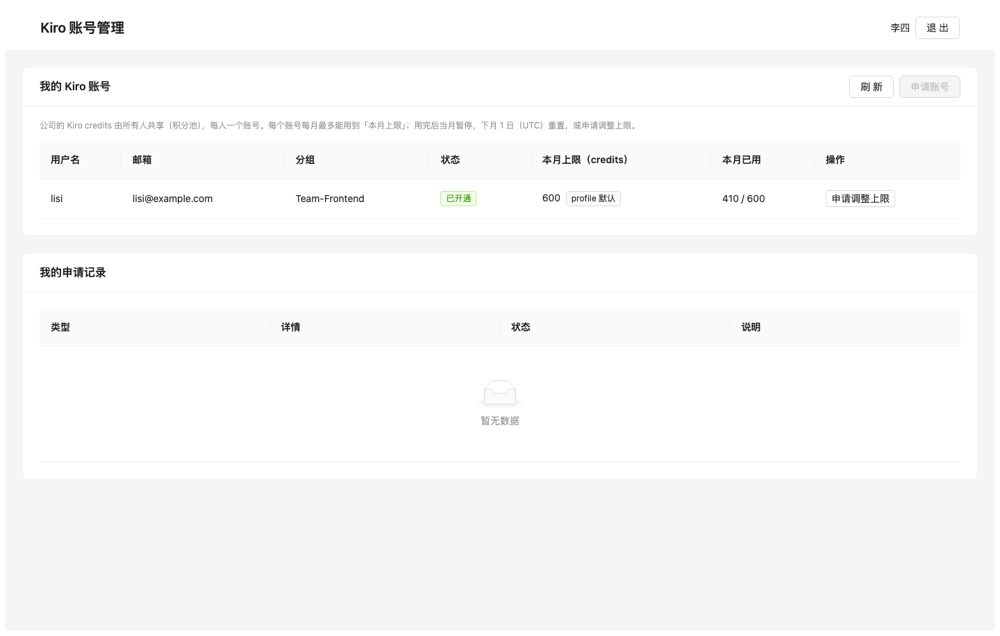 | 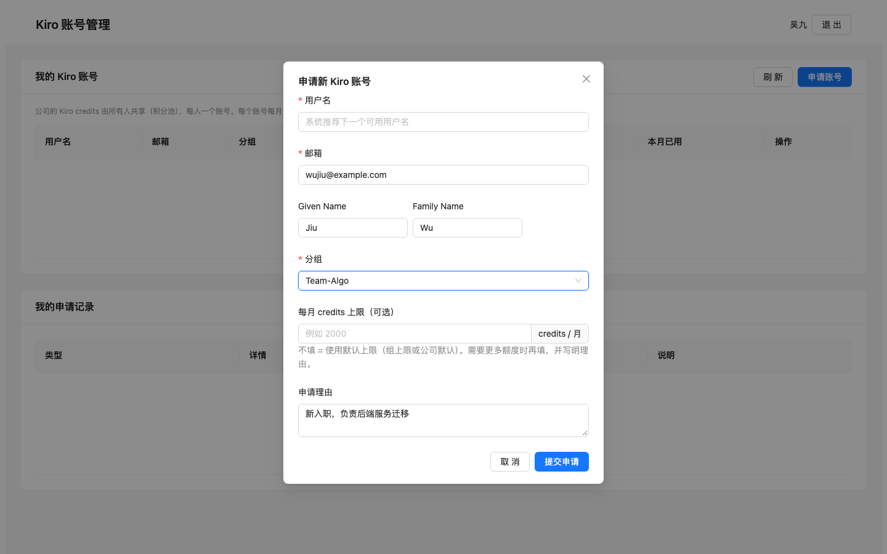 | 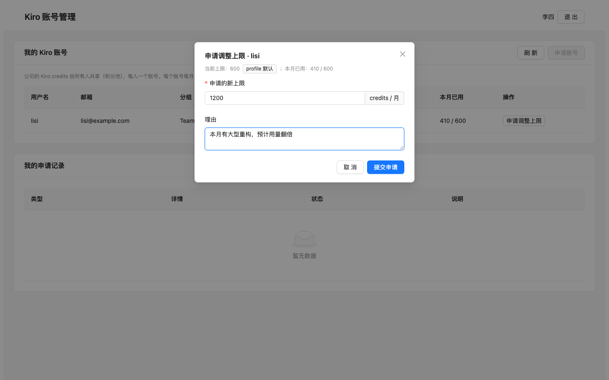 |

**管理端 · 积分池**：计费方式、剩余 credits、月度 / 追加 credits、日均消耗与预计耗尽、席位、profile 默认上限、配额、追加 credits 购买记录

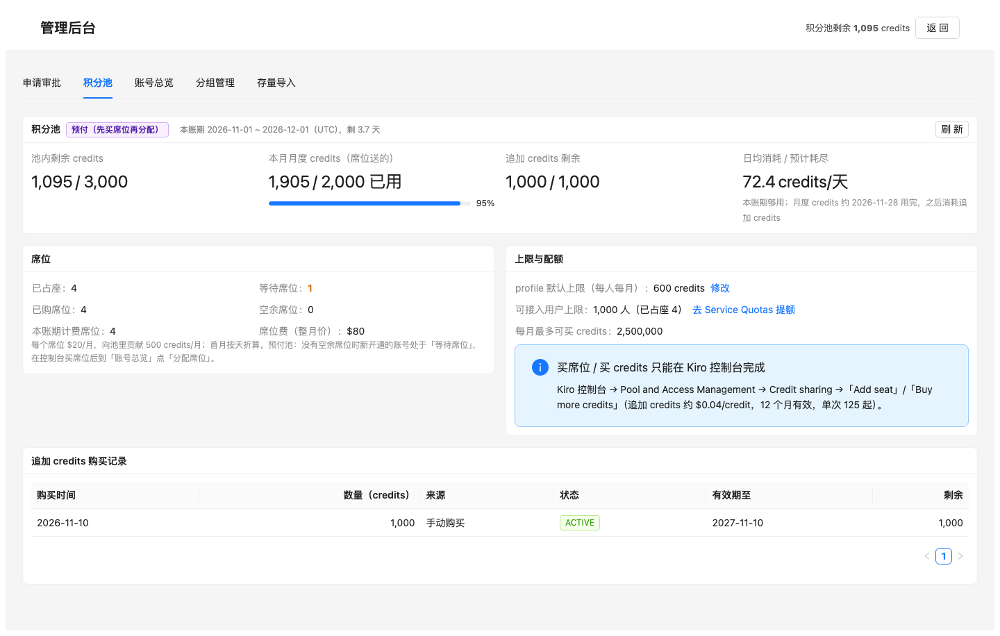

**管理端 · 账号总览**：一行一人；积分池状态、本月上限及来源、本月已用 / 上限（80% 橙、到顶红）；设上限 / 停用 / 恢复 / 分配席位 / 用量回溯

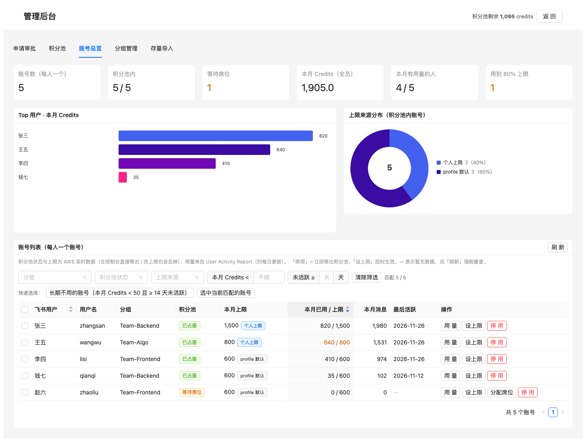

| 申请审批（含操作审计） | 设个人上限 | 批量停用 / 回收（核对 + 确认） |
|---|---|---|
| 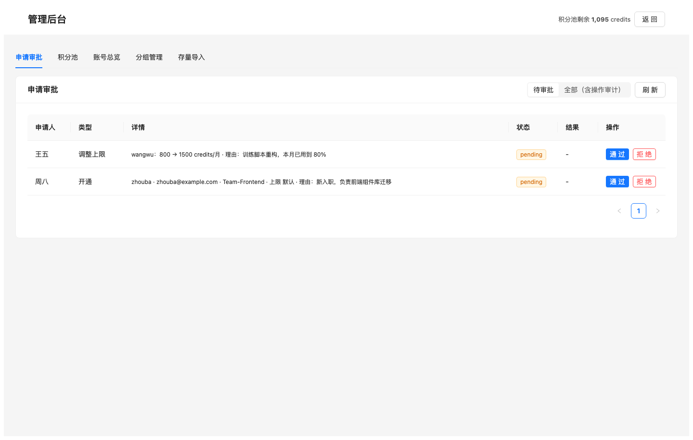 | 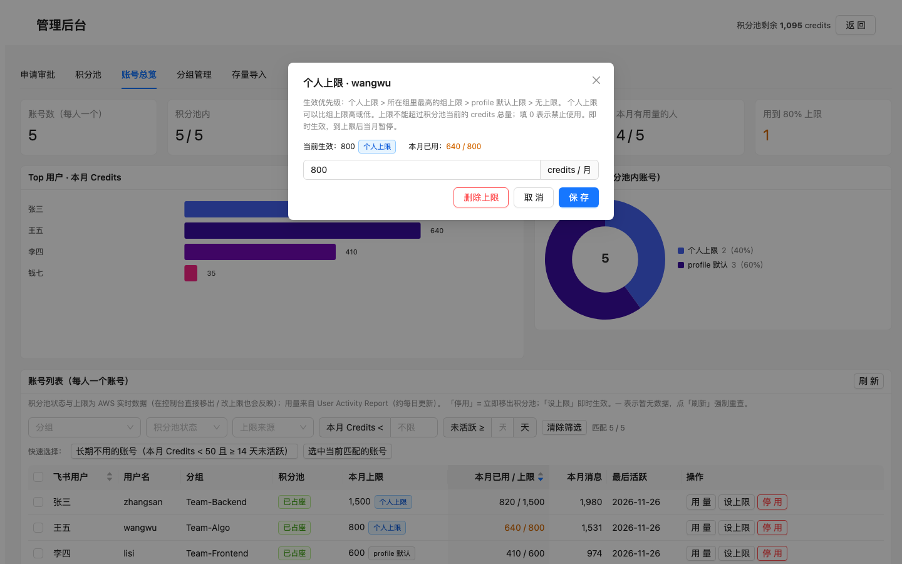 | 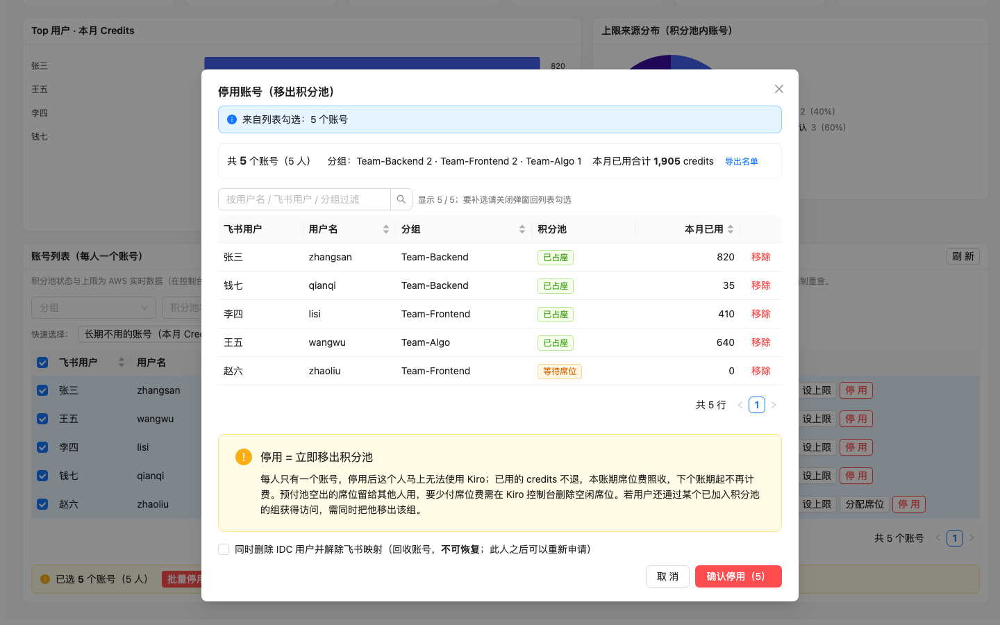 |

| 用量回溯 | 分组管理 | 存量导入（归属建议） |
|---|---|---|
| 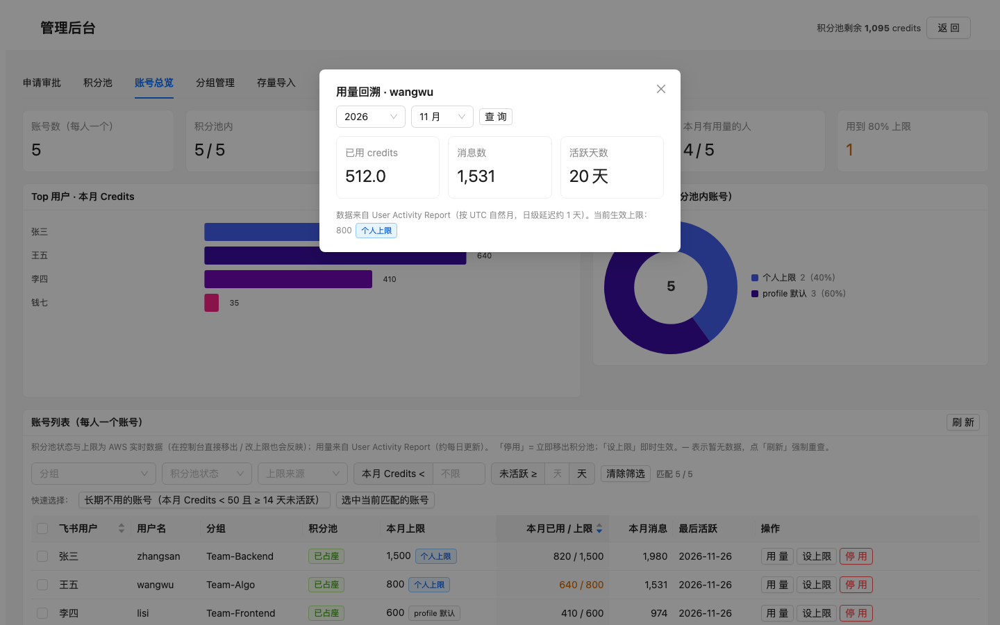 | 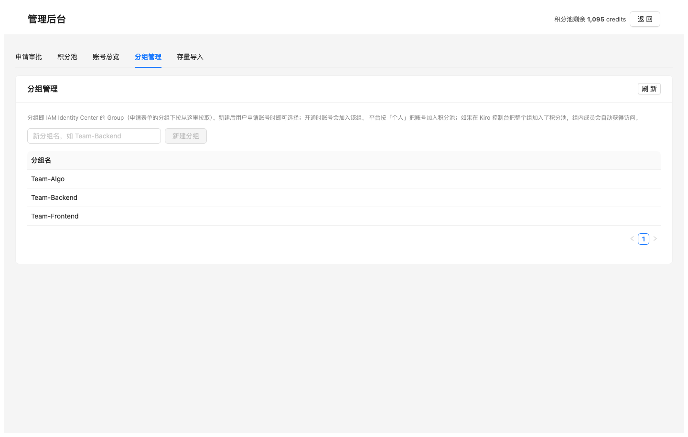 | 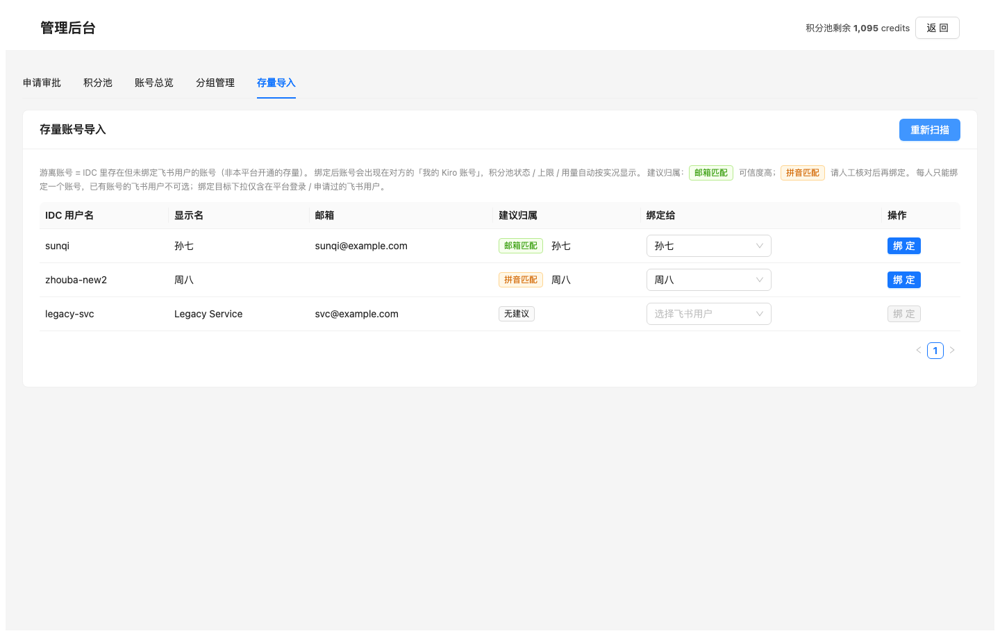 |

## 模块

```
backend/app/
├── config.py        配置层（pydantic-settings，仅资源标识，无密钥字段）
├── aws.py           AWS 会话 / 凭证唯一出口（默认链 = Role，无 AK/SK 读取路径）
├── kiro_api.py      Kiro 积分池接口 SigV4 直连（management.{region}.kiro.dev / user-subscriptions），错误分类 + 限流退避
├── pool.py          积分池领域层：池上下文 / 成员 / 席位 / 用量上限 / 余额与预计耗尽
├── provisioner.py   开通 / 调上限 / 停用 / 恢复 / 回收 / 重新分配席位（幂等，分步错误定位）
├── quotas.py        Kiro Service Quotas 只读（可接入用户上限、每月可买 credits）
├── usage.py         User Activity Report → Athena 按人 / 按月聚合（TTL 缓存，降级安全）
├── mapping_store.py DynamoDB 映射层（PK=kiro_user_id，GSI=feishu_open_id；每人一个账号）
├── resolver.py      关联解析（运行态零探测 + 存量导入归属建议 + 一人一号校验）
├── request_store.py 申请 / 审批 / 操作审计记录 + 状态机条件更新防重
├── approval.py      审批执行引擎（抢占防重 + 异步执行 + 写映射 + 通知）
├── feishu.py / feishu_ws.py / cards.py   飞书 OAuth、卡片收发、WS 长连接回调（立即响应，后台执行）
├── auth.py          JWT（密钥缺失 / 过短即拒绝服务）+ 认证依赖
├── routers/         auth / request / admin
└── main.py          FastAPI 入口（启动 WS + 托管前端，静态文件路径防穿越）
frontend/            React + TS + AntD（登录 / 我的账号 / 管理后台）
infra/
├── iam-policy.json  运行角色策略
├── create_table.py  DynamoDB 建表脚本
└── user-activity-report/   报表 S3 桶策略模板 + Athena 建表 SQL 模板
backend/tests/       moto + mock 单元测试（116 项）
```

## 核心范式

- **运行态零探测**：日常只读 DynamoDB 映射，不在热路径拼音探测 IDC
- **UserId 锚点**：以 IDC UserId（不随改名变）为主键
- **每人一个账号**：积分池 credits 全员共享，多开账号只会多占席位；申请、审批执行、绑定三处校验
- **实况优先**：积分池状态与上限每次展示都读 AWS 实况，控制台直接改动也能反映；拉取失败降级显示快照
- **无密钥**：凭证全程 IAM Role

## 本地开发

```bash
cd backend
python3 -m venv .venv && source .venv/bin/activate
pip install -r requirements.txt pytest moto
cp .env.example .env   # 只填资源标识；AWS 凭证走 aws sso / AWS_PROFILE
python -m pytest tests/ -q                       # moto mock，无需真实 AWS

# 演示服务（假数据，不连 AWS，只监听 127.0.0.1:8801）
cd ../frontend && npm ci && npm run build && cd ../backend
ADMIN_OPEN_IDS=ou_demo_admin python demo_server.py   # 输出 ADMIN_TOKEN / USER_TOKEN，写进浏览器 localStorage.token 即可
```

## 部署前置

1. 建表：`python infra/create_table.py`
2. 运行载体绑定 IAM Role，附加 `infra/iam-policy.json`
3. （可选）用量报表：按 `infra/user-activity-report/` 建 S3 桶与 Athena 表，并在 Kiro 控制台 Controls 打开 CSV 报表
4. 飞书应用、环境变量与端到端验证见 [docs/DEPLOY-AND-VERIFY.md](docs/DEPLOY-AND-VERIFY.md)

## Disclaimer

This is sample code, for non-production usage. You should work with your security
and legal teams to meet your organizational security, regulatory and compliance
requirements before deployment.

## Security

See [CONTRIBUTING](CONTRIBUTING.md#security-issue-notifications) for more information.

## License

This library is licensed under the MIT-0 License. See the [LICENSE](LICENSE) file.
